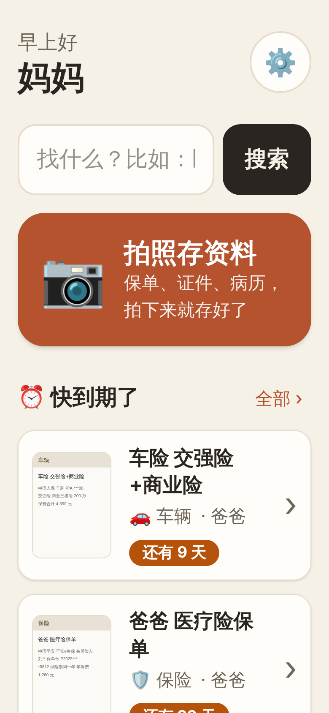
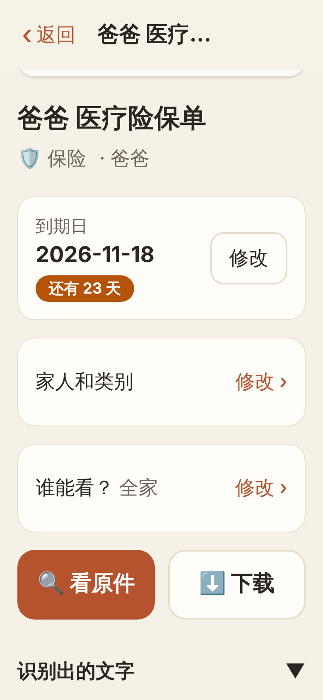
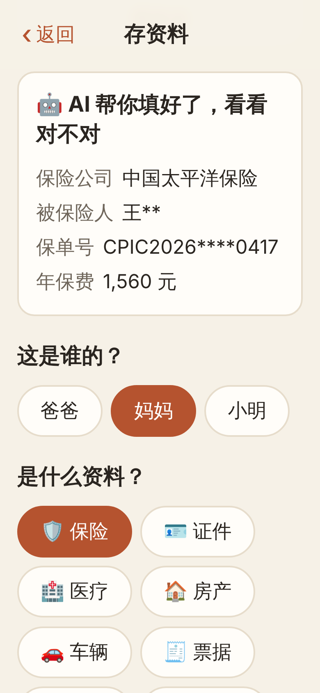

# Akasha 家里的资料

**给爸妈用的家庭资料中心，底层是 Paperless-ngx。** [English](README.md)

Akasha 是一个大字、手机优先的网页，放在 [Paperless-ngx](https://github.com/paperless-ngx/paperless-ngx) 前面。
存储、文字识别（OCR）、全文搜索、权限这些难的事交给 Paperless；Akasha 只负责让长辈用得顺手：
拍一张保单，点一下"这是谁的"，就存好了。以后按家人、按类别，或者打几个字就能找到。

名字取自虚空藏菩萨（Ākāśagarbha），意为"如虚空般无尽的宝藏"，传统上也与增强记忆相关。

<p>
  
  
  
</p>

## 功能

- 默认大字，三档字号可调；暖色高对比界面，支持深色模式
- 首页：搜索框、一个大大的"拍照存资料"按钮、快到期、按家人看、按类别看
- 拍照或从相册选，用大按钮选家人和类别
- 到期日显示"还有 N 天"，在详情页可以修改
- 中文 / English 界面
- 可以"添加到主屏幕"，像 App 一样打开
- 每个页面都有"提意见"按钮，意见会自动变成 GitHub issue，带上 `page:<页面>` 标签、路径、字号和屏幕尺寸，方便定位（没配置令牌时存到本地文件）
- 每个请求都用登录者自己的 Paperless 令牌，权限由 Paperless 决定

计划中：AI 自动提取保单号和到期日、微信到期提醒、AI 问答。

## 与 Paperless 的对应关系

| Akasha | Paperless-ngx |
| --- | --- |
| 类别（保险、证件……） | 文档类型 |
| 家人 | 名为 `家人/<名字>` 的标签（前缀可配置） |
| 到期日 | 日期类型的自定义字段 `到期日`（名称可配置） |
| 登录账号 | Paperless 用户 |

管理员可以在 **设置 → 初始化** 一键创建默认的类别、家人和到期日字段。

## 部署

需要先有一个运行中的 Paperless-ngx 2.x。

```sh
cp .env.example .env        # 填好 PAPERLESS_URL 和 AKASHA_SECRET
docker compose -f docker-compose.example.yml up -d
```

然后打开 `http://<主机>:3100`，用 Paperless 账号登录。要在家以外访问，请先加上 HTTPS（比如 Cloudflare Tunnel 或反向代理）。

## 开发

需要 Node 22.18 以上（服务端直接运行 TypeScript，不用编译）。

```sh
npm install
npm run dev     # 模拟 Paperless :8001，接口 :3000，界面 :5173
npm test        # 基于模拟 Paperless 的接口测试
```

模拟账号：`admin`/`admin`，`mama`/`mama`。

## 许可证

MIT
