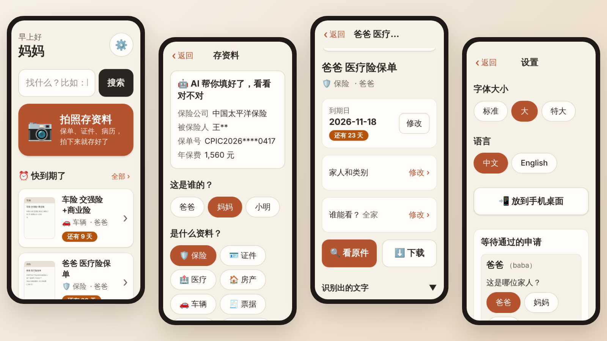

# Akasha 家里的资料

**给爸妈用的家庭资料箱。** 保单、证件拍张照，点一下"这是谁的"，就存好了；以后按家人、按类别或者搜一下就能找到。[English](README.md)



## 能做什么

- **存**：拍照、选文件，或者直接写一段文字。可选 AI 自动填好标题、家人、类别和到期日。
- **找**：搜索，按家人或类别看，快到期的一眼就能看到。
- **分享**：每份资料可以选全家看、只有自己看，或者指定某几个人。
- **为长辈设计**：字大、按钮大、默认中文，可以放到手机桌面像 App 一样打开。

Akasha 是 [Paperless-ngx](https://github.com/paperless-ngx/paperless-ngx) 的前端，文件存在你自己的 NAS 或服务器上。

## 跑起来

需要一台常开、装了 Docker 的设备（NAS 最合适），内存 4 GB 以上。

```sh
git clone https://github.com/jianhengLiu/akasha && cd akasha
cp .env.example .env    # 填好标了 required 的几项
docker compose -f docker-compose.example.yml up -d
```

打开 `http://<设备IP>:3100`，用 Paperless 管理员账号登录，在设置里点 **初始化**。之后家人在登录页申请账号，你通过就行。

完整说明（已有 Paperless、AI、HTTPS、国内拉镜像、备份）：[docs/deploy.zh-CN.md](docs/deploy.zh-CN.md)。

## 开发

```sh
npm install
npm run dev     # 模拟 Paperless + 接口 + 界面，打开 http://localhost:5173（admin/admin，mama/mama）
npm test
```

开发约定见 [CLAUDE.md](CLAUDE.md)。MIT 许可。
